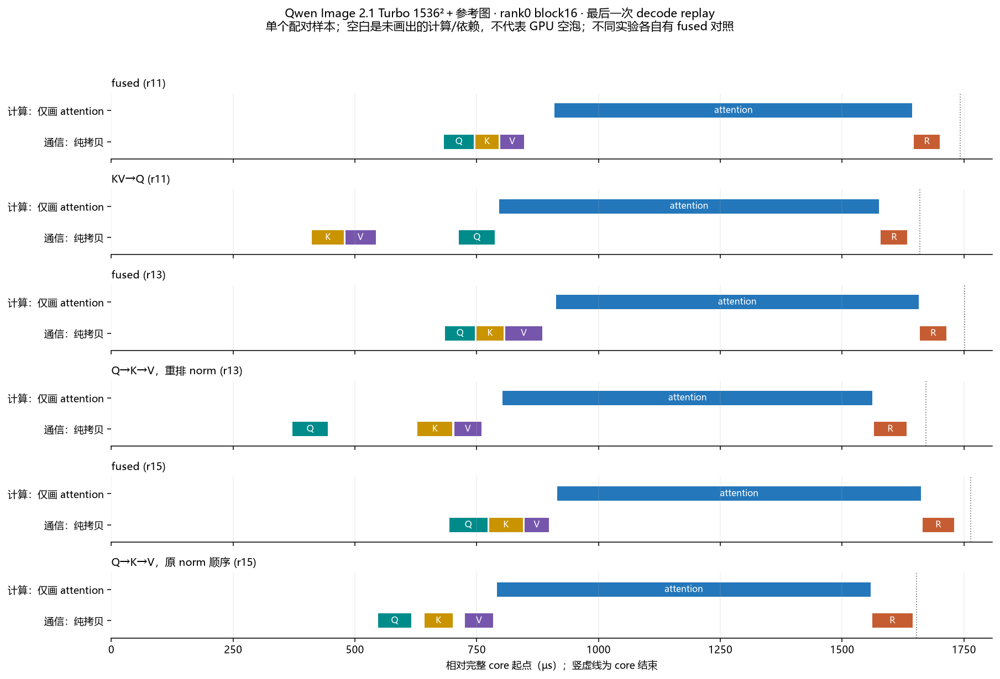

# QK/V overlap experiment — 2026-11-22

这是独立实验分支的记录。原生产默认路径保持不变；没有提交 PR。

分支：`experiment/qk-v-overlap-10448-20261122`。本次以 Qwen Image 2.1 Turbo＋参考图为锚点；没有把旧分支的 H3/FLUX/Wan 性能当作新 QKV 方案的验收结果。

## 最新正常矩阵

以下为 R16，不带诊断事件、不强制选择，30 轮配对；实测源码 `ae925b009`。小图若选择 fused，表中的波动是 A/A，不是 overlap 收益。

| shape | arm | 选择 | fused ms | arm ms | 时延下降 % |
| --- | --- | --- | --- | --- | --- |
| 1024x1024 | previous | [8] | 878.139 | 877.422 | +0.082 |
| 1024x1024 | adaptive | fused | 878.139 | 877.942 | +0.022 |
| 1536x1536 | previous | [3, 5] | 1378.901 | 1358.792 | +1.458 |
| 1536x1536 | adaptive | q_then_k_then_v | 1378.901 | 1363.193 | +1.139 |
| 2048x2048 | previous | [2, 6] | 2207.128 | 2168.155 | +1.766 |
| 2048x2048 | adaptive | q_then_k_then_v | 2207.128 | 2176.120 | +1.405 |

尚未证明新投影方案优于原 head 分块，或达到纯 P2P 的 50% 端到端净节省。保留两者的同场对比、负值和首次成本，不根据独立 core 控制外推已达标。

## 实现与可复用边界

原方案：QK 投影、原 norm/RoPE、QK 传输，与 V 投影及本地 staging 重叠。进一步对照：KV 投影、K norm/RoPE、KV 传输，与 Q 投影及 Q norm/RoPE 重叠。二者都保留一次完整 attention、一次前向 peer fence 和最终回传 fence。

最终 Q→K→V 计划使用相同两次 GEMM：QK GEMM → Q norm → K norm → Q RoPE，yield Q 后发 Q CE；K RoPE 后 yield K 并发 K CE；随后 V GEMM 和 V CE。带字段编号的 normalizer iterator 保留原 Q/K 算子顺序，模型胶水不持有 stream。分组 API 同时表达 QK/V、KV/Q、Q/K/V，不新增调度 manager。

- `StagedProjection.prepare` 使用已加载 fused 权重的连续列视图及原 scale；激活只量化一次。两次 GEMM，不拼接权重、不重复量化。当前限定对齐的 CUTLASS tensorwise FP8。
- `StagedAttention` 按字段的准备顺序调度。模型只提供投影和原有 norm/RoPE；stream、事件、copy 几何和 slot 生命周期归通用计划所有。
- 新模型需要提供 fused QKV、字段宽度/head_dim、yield `(field_id, tensor)` 的 norm/RoPE 回调和原 attention backend。尚未验收 GQA、mask/varlen、TP、LoRA、权重 reload 或其他量化后端。
- `HCMS_QKV_EXPERIMENT=1` 为显式实验开关；`HCMS_QKV_EARLY_FIELDS=qk|kv` 在模型加载时固定字段顺序。每个顺序内部学习 fused 与 staged；没有同时学习所有顺序。

## 真实调用学习与开销

使用原请求前两个真实 decode：第一个发现形状，第二个前 24 个 core 按一致轮转顺序试两个候选，每个 12 次；所有输出正常进入后续层。候选资源在试验之前准备。在已有 capture 同步点汇总各 rank 耗时，过滤未充分排队的整轮样本，保守选择后冻结并建图。

计时包含投影、QK norm/RoPE、前向通信、完整 attention、回传及必要依赖；不混入 FFN。每个首次 shape 有 64 个真实 eager core 加既有 capture 的 32 次 Python 调用，共 96 次 Python core。CUDA capture 记录图，不执行其中捕获的 kernel；这 32 次不能算额外 GPU forward。首请求剩余 5 个 decode replay，后续请求为 7 次 replay。没有用于选策略的额外 forward。

auto 首次实现/采样各记录 48 次 timing event，共 96；24 次非阻塞 query、两次控制面汇总。稳态 Python core、timing event、query、采样同步及控制面汇总均为 0。这不等于 GPU 执行中没有必要的跨 stream 事件或 peer fence。

R8 调用栈验证原粗粒度 `sampling_host_syncs=64` 实际来自 compiled-native FP8 量化器的 CPU 标量 `.item()`；core 内 CUDA scalar read 为 0，稳态 CPU scalar read 也为 0。完整首次计数保留在 CSV，不把粗粒度计数冒称成 D2H 同步。

R14 起 `sampling_host_syncs` 只计设备 scalar read 和显式同步；旧记录仍保留原计数语义。没有逐层 synchronize、设备 `.item()` 或控制面 collective。

首次探索有资源准备、事件和慢候选的成本。下表给出实际 first generate，模型加载不在计时内；权重视图在模型加载阶段准备，未单独计时。各 arm 顺序与 JIT/cache 状态不同，first generate 差值不能解释为纯探索成本。

| 阶段 | shape | arm | first ms | prepare 最大 rank ms | finish 最大 rank ms |
| --- | --- | --- | --- | --- | --- |
| fieldwise-matrix-r14 | 1024x1024 | serial1 | 4971.37 | 0.01 | 0.12 |
| fieldwise-matrix-r14 | 1024x1024 | previous | 1689.14 | 436.99 | 2.57 |
| fieldwise-matrix-r14 | 1024x1024 | adaptive | 1402.83 | 213.73 | 4.56 |
| fieldwise-matrix-r14 | 1536x1536 | serial1 | 2891.93 | 0.01 | 0.44 |
| fieldwise-matrix-r14 | 1536x1536 | previous | 2090.71 | 451.02 | 2.30 |
| fieldwise-matrix-r14 | 1536x1536 | adaptive | 1821.01 | 220.58 | 1.64 |
| fieldwise-matrix-r14 | 2048x2048 | serial1 | 3655.62 | 0.01 | 0.25 |
| fieldwise-matrix-r14 | 2048x2048 | previous | 2827.06 | 441.55 | 3.29 |
| fieldwise-matrix-r14 | 2048x2048 | adaptive | 2595.56 | 218.70 | 1.81 |
| matrix-r4 | 1024x1024 | serial1 | 4521.00 | 0.02 | 0.13 |
| matrix-r4 | 1024x1024 | previous | 1671.74 | 443.47 | 6.03 |
| matrix-r4 | 1024x1024 | adaptive | 1325.23 | 242.36 | 7.69 |
| matrix-r4 | 1536x1536 | serial1 | 2822.04 | 0.01 | 0.44 |
| matrix-r4 | 1536x1536 | previous | 2032.20 | 441.46 | 1.64 |
| matrix-r4 | 1536x1536 | adaptive | 1737.80 | 235.75 | 1.82 |
| matrix-r4 | 2048x2048 | serial1 | 3567.71 | 0.01 | 0.16 |
| matrix-r4 | 2048x2048 | previous | 2808.88 | 461.71 | 2.91 |
| matrix-r4 | 2048x2048 | adaptive | 2570.90 | 224.28 | 1.62 |
| matrix-r6 | 1024x1024 | serial1 | 3957.54 | 0.01 | 0.12 |
| matrix-r6 | 1024x1024 | previous | 1682.06 | 490.56 | 4.84 |
| matrix-r6 | 1024x1024 | adaptive | 1316.95 | 242.35 | 4.97 |
| matrix-r6 | 1536x1536 | serial1 | 2198.02 | 0.01 | 0.14 |
| matrix-r6 | 1536x1536 | previous | 2008.73 | 432.65 | 1.65 |
| matrix-r6 | 1536x1536 | adaptive | 1691.50 | 231.23 | 2.08 |
| matrix-r6 | 2048x2048 | serial1 | 3276.11 | 0.01 | 0.16 |
| matrix-r6 | 2048x2048 | previous | 2877.64 | 470.06 | 1.82 |
| matrix-r6 | 2048x2048 | adaptive | 2494.60 | 238.32 | 1.74 |
| model-order-matrix-r10 | 1024x1024 | serial1 | 4448.45 | 0.01 | 0.13 |
| model-order-matrix-r10 | 1024x1024 | previous | 1668.83 | 430.23 | 3.04 |
| model-order-matrix-r10 | 1024x1024 | adaptive | 1277.23 | 216.49 | 6.11 |
| model-order-matrix-r10 | 1536x1536 | serial1 | 2377.14 | 0.01 | 0.16 |
| model-order-matrix-r10 | 1536x1536 | previous | 2152.08 | 515.45 | 1.69 |
| model-order-matrix-r10 | 1536x1536 | adaptive | 1741.22 | 212.55 | 1.72 |
| model-order-matrix-r10 | 2048x2048 | serial1 | 3159.38 | 0.01 | 0.21 |
| model-order-matrix-r10 | 2048x2048 | previous | 2900.35 | 443.48 | 2.00 |
| model-order-matrix-r10 | 2048x2048 | adaptive | 2515.05 | 229.89 | 2.01 |
| native-ready-matrix-r16 | 1024x1024 | serial1 | 4095.61 | 0.03 | 0.16 |
| native-ready-matrix-r16 | 1024x1024 | previous | 1679.57 | 470.22 | 6.91 |
| native-ready-matrix-r16 | 1024x1024 | adaptive | 1398.10 | 221.29 | 9.16 |
| native-ready-matrix-r16 | 1536x1536 | serial1 | 2370.68 | 0.01 | 0.16 |
| native-ready-matrix-r16 | 1536x1536 | previous | 2070.05 | 424.36 | 1.56 |
| native-ready-matrix-r16 | 1536x1536 | adaptive | 1829.17 | 252.34 | 1.60 |
| native-ready-matrix-r16 | 2048x2048 | serial1 | 3054.34 | 0.01 | 0.44 |
| native-ready-matrix-r16 | 2048x2048 | previous | 2821.64 | 430.10 | 1.71 |
| native-ready-matrix-r16 | 2048x2048 | adaptive | 2625.16 | 227.96 | 1.96 |

## 端到端：全部对比

Qwen/Qwen-Image-2.1-Turbo，revision `fc13ba1986fcb905854dc8de2f52eee395f49b5b`，原 8 个 sigmas、CFG1、一个参考图、batch1，FP8 DiT、BF16 FA3、SP4，VAE patch parallel=4 及 tiling 已配置。硬件 4×NVIDIA L20X/SM90，PyTorch 2.14.0+cu130、vLLM 0.34.0。外层 engine eager，实验 harness 对 decode blocks 建图；不宣称已完成生产图模式接入。

计时从 `Omni.generate` 开始到返回，包含队列、原前缀处理、8 步及 VAE；后续 hashing/文件保存不计入。不是 HTTP 服务时延，也不是 profiler span。正式矩阵每 case 1 个首次请求、2 个额外精度 seed、30 轮轮换 arm 顺序的配对测量。

正值表示时延下降。`fused` / `[8]` 是同一路径 A/A 回退，不能计作 overlap 收益。rounds=1 的 smoke 只验精度/生命周期，包含负值，不能作为稳定性能结论。R4 norm 执行顺序与原实现不同；R6 恢复 Q norm、K norm、Q RoPE、K RoPE。KV→Q 分支独立的 K 操作在 Q 之前执行，精度需单独验证。

R14 的逐字段方案把 Q norm/RoPE 放在 K norm 之前；R15/R16 的 iterator 恢复原 Q norm、K norm、Q RoPE、K RoPE 顺序。R14 数字不能代表 R16 源码。

| 阶段 | shape | arm | 选择 | 轮数 | fused ms | arm ms | 下降 % | 配对节省 ms [95%] |
| --- | --- | --- | --- | --- | --- | --- | --- | --- |
| counter-smoke-r8 | 1536x1536 | previous | [3, 5] | 1 | 1432.759 | 1384.290 | +3.383 | 48.469 [48.469, 48.469] |
| counter-smoke-r8 | 1536x1536 | adaptive | qk_then_v | 1 | 1432.759 | 1382.992 | +3.473 | 49.767 [49.767, 49.767] |
| fieldwise-matrix-r14 | 1024x1024 | previous | [8] | 30 | 886.903 | 888.579 | -0.189 | -2.240 [-4.314, 7.823] |
| fieldwise-matrix-r14 | 1024x1024 | adaptive | fused | 30 | 886.903 | 884.564 | +0.264 | 5.826 [0.256, 10.175] |
| fieldwise-matrix-r14 | 1536x1536 | previous | [8] | 30 | 1390.995 | 1392.382 | -0.100 | -0.158 [-8.771, 8.359] |
| fieldwise-matrix-r14 | 1536x1536 | adaptive | q_then_k_then_v | 30 | 1390.995 | 1373.350 | +1.269 | 18.949 [10.886, 26.522] |
| fieldwise-matrix-r14 | 2048x2048 | previous | [2, 6] | 30 | 2205.136 | 2169.024 | +1.638 | 38.742 [32.159, 40.266] |
| fieldwise-matrix-r14 | 2048x2048 | adaptive | q_then_k_then_v | 30 | 2205.136 | 2176.997 | +1.276 | 26.261 [23.715, 29.899] |
| lifetime-smoke-r7 | 1024x1024 | previous | [8] | 1 | 886.962 | 880.842 | +0.690 | 6.120 [6.120, 6.120] |
| lifetime-smoke-r7 | 1024x1024 | adaptive | fused | 1 | 886.962 | 908.812 | -2.463 | -21.850 [-21.850, -21.850] |
| lifetime-smoke-r7 | 1536x1536 | previous | [8] | 1 | 1380.701 | 1381.461 | -0.055 | -0.760 [-0.760, -0.760] |
| lifetime-smoke-r7 | 1536x1536 | adaptive | qk_then_v | 1 | 1380.701 | 1403.838 | -1.676 | -23.138 [-23.138, -23.138] |
| lifetime-smoke-r7 | 2048x2048 | previous | [2, 6] | 1 | 2196.753 | 2171.609 | +1.145 | 25.143 [25.143, 25.143] |
| lifetime-smoke-r7 | 2048x2048 | adaptive | qk_then_v | 1 | 2196.753 | 2190.109 | +0.302 | 6.644 [6.644, 6.644] |
| matrix-r4 | 1024x1024 | previous | [8] | 30 | 874.072 | 874.066 | +0.001 | -4.966 [-10.066, 2.811] |
| matrix-r4 | 1024x1024 | adaptive | fused | 30 | 874.072 | 873.228 | +0.097 | -1.712 [-4.513, 3.770] |
| matrix-r4 | 1536x1536 | previous | [8] | 30 | 1368.367 | 1372.191 | -0.279 | 0.141 [-4.166, 3.583] |
| matrix-r4 | 1536x1536 | adaptive | qk_then_v | 30 | 1368.367 | 1358.165 | +0.746 | 13.520 [8.975, 19.130] |
| matrix-r4 | 2048x2048 | previous | [2, 6] | 30 | 2187.605 | 2149.063 | +1.762 | 40.428 [30.405, 45.753] |
| matrix-r4 | 2048x2048 | adaptive | qk_then_v | 30 | 2187.605 | 2171.480 | +0.737 | 19.096 [14.239, 24.910] |
| matrix-r6 | 1024x1024 | previous | [8] | 30 | 868.322 | 872.049 | -0.429 | -0.474 [-4.983, 6.092] |
| matrix-r6 | 1024x1024 | adaptive | fused | 30 | 868.322 | 871.239 | -0.336 | -3.082 [-6.098, 4.191] |
| matrix-r6 | 1536x1536 | previous | [3, 5] | 30 | 1375.249 | 1358.098 | +1.247 | 19.682 [14.638, 24.531] |
| matrix-r6 | 1536x1536 | adaptive | qk_then_v | 30 | 1375.249 | 1367.674 | +0.551 | 8.453 [5.848, 15.217] |
| matrix-r6 | 2048x2048 | previous | [2, 6] | 30 | 2191.732 | 2159.123 | +1.488 | 34.853 [29.407, 41.621] |
| matrix-r6 | 2048x2048 | adaptive | qk_then_v | 30 | 2191.732 | 2174.607 | +0.781 | 19.813 [15.700, 23.245] |
| model-order-matrix-r10 | 1024x1024 | previous | [8] | 30 | 894.864 | 896.502 | -0.183 | -1.553 [-6.593, 5.973] |
| model-order-matrix-r10 | 1024x1024 | adaptive | fused | 30 | 894.864 | 895.243 | -0.042 | -0.852 [-5.078, 7.413] |
| model-order-matrix-r10 | 1536x1536 | previous | [3, 5] | 30 | 1393.815 | 1371.694 | +1.587 | 20.352 [14.104, 23.113] |
| model-order-matrix-r10 | 1536x1536 | adaptive | kv_then_q | 30 | 1393.815 | 1376.851 | +1.217 | 18.565 [15.280, 22.000] |
| model-order-matrix-r10 | 2048x2048 | previous | [2, 6] | 30 | 2209.170 | 2172.034 | +1.681 | 36.184 [34.594, 39.227] |
| model-order-matrix-r10 | 2048x2048 | adaptive | kv_then_q | 30 | 2209.170 | 2179.221 | +1.356 | 32.727 [27.849, 35.226] |
| model-order-smoke-r10 | 1536x1536 | previous | [3, 5] | 1 | 1432.725 | 1395.946 | +2.567 | 36.779 [36.779, 36.779] |
| model-order-smoke-r10 | 1536x1536 | adaptive | kv_then_q | 1 | 1432.725 | 1416.241 | +1.151 | 16.484 [16.484, 16.484] |
| native-ready-matrix-r16 | 1024x1024 | previous | [8] | 30 | 878.139 | 877.422 | +0.082 | -1.599 [-5.886, 6.871] |
| native-ready-matrix-r16 | 1024x1024 | adaptive | fused | 30 | 878.139 | 877.942 | +0.022 | -0.983 [-3.649, 4.147] |
| native-ready-matrix-r16 | 1536x1536 | previous | [3, 5] | 30 | 1378.901 | 1358.792 | +1.458 | 19.308 [16.722, 23.279] |
| native-ready-matrix-r16 | 1536x1536 | adaptive | q_then_k_then_v | 30 | 1378.901 | 1363.193 | +1.139 | 17.854 [14.792, 22.004] |
| native-ready-matrix-r16 | 2048x2048 | previous | [2, 6] | 30 | 2207.128 | 2168.155 | +1.766 | 39.150 [32.871, 40.760] |
| native-ready-matrix-r16 | 2048x2048 | adaptive | q_then_k_then_v | 30 | 2207.128 | 2176.120 | +1.405 | 34.466 [28.317, 36.635] |
| smoke-r4 | 1536x1536 | previous | [8] | 1 | 1437.223 | 1376.169 | +4.248 | 61.054 [61.054, 61.054] |
| smoke-r4 | 1536x1536 | adaptive | qk_then_v | 1 | 1437.223 | 1394.653 | +2.962 | 42.570 [42.570, 42.570] |

配对区间为固定 seed bootstrap 的配对差值中位数 95% 区间；下降百分比为两 arm 中位数之差/基线中位数，两者口径不同。

## 理论窗口与全部独立 core 控制

单独 QK→V 的毛收益上限是 `min(QK peer CE, V GEMM + 本地 V staging)`。KV→Q 把后者换为 Q 投影、Q norm/RoPE 和 Q staging，扩大了可重叠窗口。最终逆向通信仍串行；不能直接承诺减半总 P2P。

Q/K/V 三段用独立控制估计依赖窗口：令 Q/K CE 为 cq/ck、Q 发出后余下 K 准备与 staging 为 Tk、V 准备与 staging 为 Tv，预测可隐藏量为 `cq + ck - max(0, max(Tk, cq) + ck - (Tk + Tv))`。这是分开测量的成本模型，不是同请求硬件 busy 上限；各控制的缓存状态和 marker 数不同，不能把独立 Q/K 窗口相加后当成模型内实际 P2P。

使用实际 checkpoint 权重、合成激活/前缀、3 seeds、4 ranks。每项 30 轮×8 replay，按轮次反转/轮转测量顺序。各 arm 都返回共享输出槽，已排除 output clone 所有权差异。

| 阶段 | shape | 层 | 早发 | fused µs | split serial µs | overlap µs | 生产者差 µs | 毛节省 µs | 净节省 µs | 窗口 µs | 毛节省/窗口 % |
| --- | --- | --- | --- | --- | --- | --- | --- | --- | --- | --- | --- |
| r12 | 1024 | 0 | kv deferred/compute | 682.72 | 669.43 | 603.81 | -11.57 | 65.62 | 78.91 | 81.66 | 80.35 |
| r12 | 1536 | 0 | kv deferred/compute | 1739.27 | 1724.47 | 1595.37 | -7.96 | 129.10 | 143.90 | 150.53 | 85.77 |
| r12 | 2048 | 0 | kv deferred/compute | 3603.70 | 3549.20 | 3337.75 | -17.03 | 211.44 | 265.94 | 260.83 | 81.07 |
| r13 | 1024 | 0 | q|k|v/compute | 682.11 | 675.72 | 613.36 | -4.06 | 62.36 | 68.75 | 88.88 | 70.16 |
| r13 | 1536 | 0 | q|k|v/compute | 1735.92 | 1733.24 | 1605.50 | 2.91 | 127.75 | 130.43 | 163.44 | 78.16 |
| r13 | 2048 | 0 | q|k|v/compute | 3589.21 | 3548.95 | 3339.00 | -0.22 | 209.95 | 250.21 | 266.27 | 78.85 |
| r15 | 1024 | 0 | q|k|v/compute | 681.13 | 683.40 | 620.84 | 3.11 | 62.55 | 60.28 | 87.81 | 71.24 |
| r15 | 1536 | 0 | q|k|v/compute | 1734.32 | 1733.13 | 1606.06 | 6.57 | 127.08 | 128.26 | 163.75 | 77.60 |
| r15 | 2048 | 0 | q|k|v/compute | 3602.26 | 3563.10 | 3332.16 | 2.54 | 230.94 | 270.10 | 264.32 | 87.37 |
| r15-kv | 1024 | 0 | kv/compute | 681.63 | 669.21 | 604.47 | -10.86 | 64.74 | 77.16 | 80.85 | 80.08 |
| r15-kv | 1536 | 0 | kv/compute | 1737.83 | 1728.34 | 1598.46 | -8.05 | 129.88 | 139.37 | 153.30 | 84.73 |
| r15-kv | 2048 | 0 | kv/compute | 3594.68 | 3563.98 | 3336.32 | -16.73 | 227.66 | 258.37 | 259.73 | 87.65 |
| r17 | 1024 | 0 | q|k|v/communication | 682.16 | 683.52 | 666.83 | 3.26 | 16.69 | 15.34 | 88.59 | — |
| r17 | 1536 | 0 | q|k|v/communication | 1736.41 | 1737.06 | 1677.19 | 6.12 | 59.87 | 59.22 | 163.52 | — |
| r17 | 2048 | 0 | q|k|v/communication | 3579.76 | 3546.06 | 3441.83 | 2.17 | 104.23 | 137.93 | 265.58 | — |
| r3 | 1024 | 0 | qk/compute | 675.94 | 674.48 | 636.23 | 1.97 | 38.25 | 39.71 | 27.53 | 138.92 |
| r3 | 1536 | 0 | qk/compute | 1729.74 | 1734.34 | 1657.46 | 7.77 | 76.88 | 72.29 | 60.22 | 127.66 |
| r3 | 2048 | 0 | qk/compute | 3571.10 | 3564.23 | 3430.02 | 2.53 | 134.21 | 141.08 | 98.10 | 136.81 |
| r4 | 1024 | 0 | qk/compute | 677.09 | 674.61 | 635.70 | 1.92 | 38.91 | 41.39 | 43.54 | 89.37 |
| r4 | 1536 | 0 | qk/compute | 1734.14 | 1732.15 | 1658.80 | 9.59 | 73.35 | 75.34 | 80.02 | 91.67 |
| r4 | 2048 | 0 | qk/compute | 3592.05 | 3566.65 | 3445.82 | 6.84 | 120.82 | 146.23 | 125.73 | 96.09 |
| r4 | 1024 | 16 | qk/compute | 675.35 | 677.50 | 637.26 | 2.11 | 40.24 | 38.09 | 43.44 | 92.65 |
| r4 | 1536 | 16 | qk/compute | 1739.25 | 1740.53 | 1664.90 | 5.94 | 75.63 | 74.35 | 80.44 | 94.02 |
| r4 | 2048 | 16 | qk/compute | 3618.32 | 3598.15 | 3472.08 | 3.73 | 126.07 | 146.24 | 125.97 | 100.08 |
| r4 | 1024 | 31 | qk/compute | 676.75 | 675.30 | 638.40 | 2.68 | 36.90 | 38.35 | 43.62 | 84.59 |
| r4 | 1536 | 31 | qk/compute | 1740.92 | 1743.89 | 1666.95 | 7.56 | 76.94 | 73.96 | 79.89 | 96.30 |
| r4 | 2048 | 31 | qk/compute | 3601.74 | 3578.22 | 3466.32 | 1.33 | 111.90 | 135.42 | 126.56 | 88.41 |
| r6 | 1024 | 0 | qk/compute | 682.18 | 683.16 | 645.61 | 3.00 | 37.54 | 36.57 | 43.53 | 86.24 |
| r6 | 1536 | 0 | qk/compute | 1738.90 | 1739.53 | 1662.66 | 7.01 | 76.87 | 76.24 | 79.97 | 96.13 |
| r6 | 2048 | 0 | qk/compute | 3585.95 | 3556.41 | 3446.62 | 8.09 | 109.79 | 139.32 | 125.95 | 87.16 |
| r9-kv | 1024 | 0 | kv/compute | 685.56 | 669.99 | 605.75 | -11.29 | 64.24 | 79.81 | 79.20 | 81.11 |
| r9-kv | 1536 | 0 | kv/compute | 1743.41 | 1729.54 | 1599.55 | -8.25 | 129.99 | 143.86 | 153.66 | 84.59 |
| r9-kv | 2048 | 0 | kv/compute | 3610.46 | 3556.82 | 3332.89 | -14.12 | 223.93 | 277.57 | 261.39 | 85.67 |
| r9-qk | 1024 | 0 | qk/compute | 684.29 | 684.15 | 644.38 | 2.81 | 39.77 | 39.91 | 43.53 | 91.36 |
| r9-qk | 1536 | 0 | qk/compute | 1741.73 | 1739.87 | 1660.51 | 7.11 | 79.37 | 81.23 | 80.16 | 99.01 |
| r9-qk | 2048 | 0 | qk/compute | 3604.14 | 3567.55 | 3438.87 | 4.53 | 128.68 | 165.27 | 125.62 | 102.44 |

R3 的旧 `v_overlap_bound_us` 只含 V GEMM，遗漏 local staging，不能作为完整上限；其超 100% 比例不说明突破理论。R4/R6 修正，R9 使用通用 remaining-ready 字段。serial 相比 fused 还包含字段布局与 norm 顺序变化，因此净节省中不能全归因于 overlap。communication-staging 行的窗口列仍是 compute-staging 独立控制，不能作为该新调度的上限，所以不计算达成率。

## 通信分母

冻结的相同 fused QKV / contiguous joint-KV 几何控制如下，统计 `median_round max_rank(F_rank + R_rank)`，不是两个阶段分别取最大值后相加。只包含纯 P2P CE 窗口，不含 barrier、本地 staging 和 stream wait；仍含 marker/copy 间调度间隔，非硬件 memcpy busy union。下面的请求占比是 ×224 个 decode core 的估计，没有实测整个请求的通信占用。

| shape | 纯 P2P µs/core | ×224 ms | 相对 R6 generate 估计 % |
| --- | --- | --- | --- |
| 1024 | 157.584 | 35.299 | 4.065 |
| 1536 | 311.920 | 69.870 | 5.081 |
| 2048 | 539.072 | 120.752 | 5.509 |

## 模型内损失定位

R6 QK→V 等量完整 core 事件：1536² 最后一次 decode replay，4 对请求、全部 32 层、4 ranks。每 arm 每步 66 个外部 marker，取组件耗时最大 rank，所有分项沿用同一 rank。core 含 QKV 投影/norm/RoPE；other 包含 out projection、FFN、其他算子及调度间隙。

qkv-all-core-spans

| arm | component ms | core 合计 ms | other ms |
| --- | --- | --- | --- |
| serial1 | 83.147 | 56.654 | 26.494 |
| adaptive | 82.193 | 55.364 | 26.829 |

kv-all-core-spans

| arm | component ms | core 合计 ms | other ms |
| --- | --- | --- | --- |
| serial1 | 83.049 | 56.457 | 26.592 |
| adaptive | 80.743 | 53.692 | 27.051 |

kv-peer-core-spans

| arm | component ms | core 合计 ms | other ms |
| --- | --- | --- | --- |
| serial1 | 83.321 | 56.967 | 26.354 |
| adaptive | 80.681 | 53.433 | 27.248 |

R6 完整 core 合计约省 1.289 ms，other 增加 0.335 ms，整步净省 0.954 ms。按最后一步外推 7 个 decode 约 6.681 ms，接近未加事件矩阵 7.575 ms 的中位数差。独立 layer0 core 的 76.24 µs×224≈17.08 ms 外推明显过高。完整 core 的事件还不能区分通信、norm、attention 和 peer 等待的根因；没有证据时不把剩余差距武断归为 SM/HBM 竞争。

等量细分 Q/K/V peer copy、attention、回传事件诊断单独存档；其外部 marker 更多，不用于主性能表。

## 1536²＋参考图：净收益被什么抵消

R11/R12/R13/R15 逐字段事件诊断均取最后一次 decode、32 层、4 对请求；每个 arm 每步 386 个外部 marker，各请求沿用 component 最大 rank 的全部分项。以下除 component 外都已除以 32，单位 µs/core。正的“节省”代表加速，正的“增加”代表回吐。pre/attention/post 可相加，P2P 是与它们重叠的单独口径，不能再相加。

正常 R16 与纯 P2P 目标的对照如下。通信部分为最后 decode/独立控制外推，不包含首步前缀处理或 VAE 通信，不是整个请求的实测通信占用；1536 使用 R15 模型内基线，其余沿用冻结独立几何。

| shape | P2P µs/core | 估计 decode P2P 占请求 % | 一半 P2P ms | 正常请求净省 ms | 净省/估计 P2P % |
| --- | --- | --- | --- | --- | --- |
| 1536 | 259.77 | 4.22 | 29.09 | 15.71 | 27.00 |
| 2048 | 539.07 | 5.47 | 60.38 | 31.01 | 25.68 |

| 阶段/arm | 纯 P2P fused→staged | pre 节省 | attention 增加 | post 节省 | core 节省 | other 增加 | component 节省 ms |
| --- | --- | --- | --- | --- | --- | --- | --- |
| peer-phases-r11/adaptive | 261.07→260.67 | 139.87 | 31.86 | 2.45 | 110.46 | 27.95 | 2.640 |
| admission-phases-r12/adaptive | 262.20→253.11 | 107.26 | 33.66 | 2.77 | 76.38 | 23.08 | 1.706 |
| admission-phases-r12/deferred | 262.20→256.55 | 131.28 | 45.00 | 14.09 | 100.37 | 31.22 | 2.213 |
| fieldwise-phases-r13/adaptive | 260.57→261.66 | 105.61 | 7.71 | -18.74 | 79.16 | 9.09 | 2.242 |
| native-ready-phases-r15/adaptive | 259.77→247.72 | 130.60 | 36.43 | 20.14 | 114.30 | 17.32 | 3.104 |

R11 实测基线 P2P 约 261 µs/core，冻结独立控制为 312 µs/core；后者在此锚点高约 20%，即真实分母比旧分母低约 16%。二者测量环境与 rank 汇总规则不同，不能互换。没有将 barrier/快慢 rank 等待计为纯通信。该新方案保持相同 P2P 字节数，改变的是重叠时机。

优化过程与结论：

- QK→V 的主要覆盖窗口仅 V GEMM＋staging，约 44/80/126 µs，天然小于总通信的一半；扩大为 KV→Q 后，独立 core 净节省约 80/144/278 µs。
- KV→Q 在模型内省下约 140 µs 的 attention 前时间，但 attention 增加约 32 µs、other 增加约 28 µs，解释了独立 core 与 E2E 的差距。
- R12 只把原有 readiness 事件后移到 Q GEMM 后，未增加 kernel 或 fence。attention 反而再慢约 11 µs/core；拒绝此方案，已撤回运行时开关，保留失败证据。诊断中等待重分配带来的 component 波动不能算正常 E2E 收益。
- R13 让 Q/K 分别准备完成即发布，恢复 Q→K→V 到达顺序。attention 增幅降到约 8 µs/core，但前后等待增加，R14 正常矩阵仍仅约 1.27%，没有稳定优于 KV→Q。
- R15/R16 用 incremental normalizer 保留原生算子顺序，依旧两次 GEMM、一次量化、一次完整 attention、三个字段依赖。没有新增 norm/RoPE 算子、copy、peer fence。R15 attention 增幅又达到约 36 µs/core，但 pre/post 等待更少。不能只优化 attention 单项而忽略完整 core。

- R17 在不增加 copy、事件或 fence 的前提下，把本地 staging 移到通信 stream，完整 core 的 overlap 时长变为 666.83/1677.19/3441.83 µs，相比 R15 的 620.84/1606.06/3332.16 µs 明显退步。该队列现在串行执行 local 和 peer copy，失去了原先下一字段 local staging 与上一字段 peer copy 并行的机会。撤回此改动，保留源 SHA、精度与压力测试证据，不再为该候选运行大矩阵，也没有留下无效运行时开关。

已确认的是调度方案改变了后续 attention/其他组件的执行时长；缓存、HBM 竞争、地址布局或频率变化等物理解释仍未分离。不同诊断轮次的差值不是严格的同场因果实验。当前没有证明可以消除全部回吐，也没有证明达到“净节省 ≥ 总 P2P 的一半”。

QKV 分离计划保留完整 attention，因此最终回传只能在它之后进行。要继续扩大覆盖范围，需要改变依赖结构，例如回到 attention head 分块；不能靠删除保护 slot 生命周期的 fence 来获取虚假收益。当前新计划不替代更快的原 head 方案；新模型接入和生产支持仍需独立验收。

图中空白包含未绘出的计算和依赖，并不代表 GPU 空泡。单个 rank/layer 样本用于看时间关系，数值结论使用四 rank、所有层和全部配对样本。

## 验证、失败与证据

已完成 1581 个正常请求、42 项对比、36 项独立 core 控制、7 组 slot stress；另有 91 个带事件诊断请求。

所有完成请求按记录的 42/43/44 seed 比较像素哈希；smoke 包含原 Ulysses eager。独立 Q/K/V 及完整 core 与原 Ulysses 全部逐位一致。对称内存 stress 施加各 rank 不同的生产者/旧输出消费者延迟，验证 eager、capture/replay 和原型释放。保留全部 rank 决策、采样、执行计数、首次成本和源文件哈希。

| 保留的失败 | exit | 原因 |
| --- | --- | --- |
| hcms-10448-qkv-core-20261122-r1 | 1 | [rank2]: AssertionError: Current vLLM config is not set. This typically means get_current_vllm_config() was called outside of a set_current_vllm_config() context, or a CustomOp was instantiated at module import time or model forward time when config is not set. For tests that directly test custom ops/modules, use the 'default_vllm_config' pytest fixture from tests/conftest.py.; [rank1]: AssertionError: Current vLLM config is not set. This typically means get_current_vllm_config() was called outside of a set_current_vllm_config() context, or a CustomOp was instantiated at module import time or model forward time when config is not set. For tests that directly test custom ops/modules, use the 'default_vllm_config' pytest fixture from tests/conftest.py.; [rank3]: AssertionError: Current vLLM config is not set. This typically means get_current_vllm_config() was called outside of a set_current_vllm_config() context, or a CustomOp was instantiated at module import time or model forward time when config is not set. For tests that directly test custom ops/modules, use the 'default_vllm_config' pytest fixture from tests/conftest.py.; [rank0]: AssertionError: Current vLLM config is not set. This typically means get_current_vllm_config() was called outside of a set_current_vllm_config() context, or a CustomOp was instantiated at module import time or model forward time when config is not set. For tests that directly test custom ops/modules, use the 'default_vllm_config' pytest fixture from tests/conftest.py.; torch.distributed.elastic.multiprocessing.errors.ChildFailedError:  |
| hcms-10448-qkv-core-20261122-r2 | 1 | [rank2]: RuntimeError: Expected original fused QK norm/RoPE; [rank3]: RuntimeError: Expected original fused QK norm/RoPE; [rank0]: RuntimeError: Expected original fused QK norm/RoPE; [rank1]: RuntimeError: Expected original fused QK norm/RoPE; torch.distributed.elastic.multiprocessing.errors.ChildFailedError:  |

最初 r1 缺少 VllmConfig 上下文，r2 对 SM90 的 fused QK norm/RoPE 资格判断过宽。修复后重新运行，没有从失败任务提取性能数字。当前 SM90 使用原 Diffusers RMSNorm 与原 RoPE，未放宽精度门槛、未更新共享依赖。

性能和源代码按每行 SHA 绑定。R6 性能 SHA 为 `31cbcf0123dc33bbb6915365f715632ed2b941f1`；后续构造期引用/计划 owner 清理由 R7 验证，R8 增加计数分类。R9 改了字段顺序实现，必须按 R9/R10 的独立数据评估，不能把旧性能当成新 HEAD 的结果。R14 性能源码 `c1fe3b8b5`；R15/R16 源码 `ae925b009`。后续仅报告/说明提交不改变测量代码。

源内入口：[原 QK/V 矩阵](ci-qkv-turbo-matrix.json)、[最终 Q/K/V 矩阵](ci-qkv-fieldwise-matrix.json)、[精度 smoke](ci-qkv-turbo-smoke.json)、[独立控制](qkv_budget.py)、[生命周期压力](staged_slot_stress.py)。实际运行采用 `native-probe.patch`、`model-probe.patch`、`qwen21-block-graph.patch`；每次保存实际 patch、payload、exit-code、源 SHA256、checkpoint manifest 和 audit 后恢复 checkout。

完整表格：[所有性能对比](qkv-results-20261122/all-comparisons.csv)、[所有独立 core](qkv-results-20261122/core-summary.csv)、[首次成本](qkv-results-20261122/first-shape-summary.csv)、[phase 分解](qkv-results-20261122/phase-ledger.csv)、[通信与目标](qkv-results-20261122/target-ledger.csv)、[最终源码核对](qkv-results-20261122/latest-forward-provenance.json)、[自查](qkv-results-20261122/SELF_REVIEW.md)。完整运行日志和所有 rank audit 保留于单独证据包，不把权重或生成图片提交到仓库。

AI assistance: Codex 编写原型、测试和分析。此分支用于调查，不宣称已达到生产接入或 PR 验收条件。
